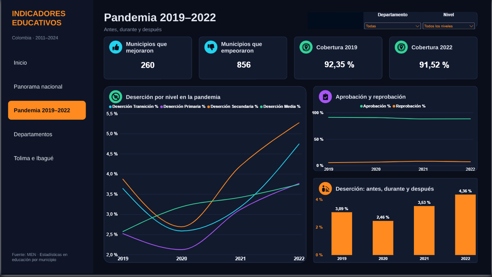
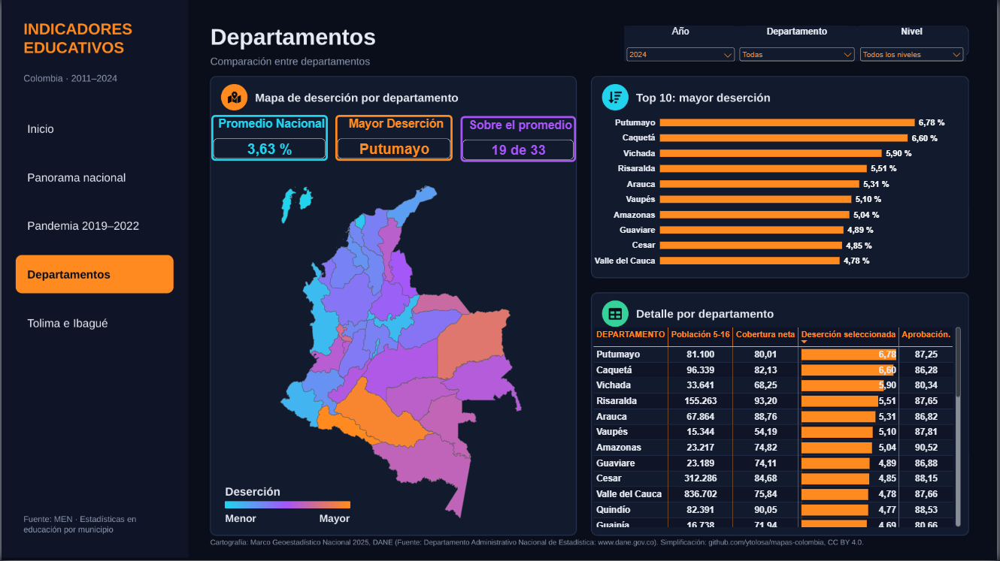

# Análisis de Indicadores Educativos en Colombia

Proyecto formativo del SENA · Python · Pandas · NumPy · Google Colab · Power BI

## Descripción

Análisis de indicadores del sector educativo colombiano a partir de las estadísticas del Ministerio de Educación Nacional (MEN). Se limpiaron y validaron los datos con Python en Google Colab y se construyó un dashboard interactivo en Power BI que compara el panorama nacional, el periodo de pandemia, los departamentos y el caso de Tolima e Ibagué.

## Objetivos

- Analizar los indicadores de aprobación, reprobación y deserción escolar.
- Examinar la cobertura educativa neta y bruta.
- Comparar el comportamiento de los indicadores durante 2019–2022.
- Identificar diferencias entre departamentos y municipios.
- Analizar el contexto educativo de Tolima e Ibagué.

## Herramientas utilizadas

| Tecnología | Uso |
|---|---|
| Python | Procesamiento de datos |
| Pandas | Limpieza y manipulación |
| NumPy | Operaciones numéricas |
| Google Colab | Desarrollo del notebook |
| Power BI | Análisis y visualización |
| Excel | Exportación y consulta de datos |

## Competencias desarrolladas

- **Limpieza y transformación de datos:** depuración, estandarización y preparación de datos utilizando Python.
- **Análisis de datos con Pandas y NumPy:** manipulación de estructuras de datos, conversión de variables y tratamiento de valores nulos.
- **Validación de calidad de datos:** identificación de duplicados, revisión de inconsistencias y comprobación de integridad de los registros.
- **Análisis exploratorio de datos (EDA):** identificación de patrones, tendencias y diferencias en los indicadores educativos.
- **Visualización de datos:** diseño de dashboards interactivos en Power BI.
- **Análisis comparativo:** evaluación de indicadores educativos entre años, departamentos y municipios.
- **Comunicación de resultados:** presentación de hallazgos mediante visualizaciones y documentación técnica.
- **Documentación y control de versiones:** organización de archivos y publicación del proyecto en GitHub.

## Fuente de los datos

- **Entidad:** Ministerio de Educación Nacional (MEN), Colombia.
- **Conjunto:** Estadísticas en educación en preescolar, básica y media por municipio.
- **Portal de descarga:** [Datos abiertos de Colombia – MEN](https://www.datos.gov.co/Educaci-n/MEN_ESTADISTICAS_EN_EDUCACION_EN_PREESCOLAR-B-SICA/nudc-7mev).
- **Archivo original:** `MEN_ESTADISTICAS_EN_EDUCACION_EN_PREESCOLAR,_BÁSICA_Y_MEDIA_POR_MUNICIPIO_20261118.csv`.
- **Cobertura:** 2011 a 2024, por municipio.

Los límites departamentales del mapa provienen del DANE (Marco Geoestadístico Nacional 2025), simplificados a partir de [ytolosa/mapas-colombia](https://github.com/ytolosa/mapas-colombia), bajo licencia CC BY 4.0.

## Metodología

1. Obtención de los datos desde la fuente oficial del MEN.
2. Limpieza y transformación con Python, Pandas y NumPy: estandarización de códigos con ceros a la izquierda, corrección de separadores numéricos, conversión de porcentajes y normalización de nombres de municipios.
3. Validación de consistencia: duplicados, correspondencia entre municipio y departamento, sumas de aprobación, reprobación y deserción, y comparación de los datos contra la fuente.
4. Exportación de los datos procesados a Excel.
5. Desarrollo del dashboard interactivo en Power BI.
6. Análisis de indicadores y comparación territorial.

## Datos procesados

Como resultado del proceso de limpieza y transformación se generó un archivo Excel preparado para el análisis de los indicadores educativos.

**[Descargar MEN_ESTADISTICAS_LIMPIO.xlsx](01_Datos/MEN_ESTADISTICAS_LIMPIO.xlsx)**

El archivo contiene la base de datos limpia y organizada para su consulta y utilización en Power BI.

## Notebook de Python

El proceso de limpieza, transformación y validación se desarrolló en Google Colab utilizando Python, Pandas y NumPy.

**[Ver notebook de limpieza y transformación](02_Python/Limpieza_Dataset_Indicadores_Educativos.ipynb)**

Para reproducir el análisis:

1. Descarga el CSV original desde el portal del MEN.
2. Abre el notebook en Google Colab.
3. Sube el archivo CSV al panel de archivos de Colab.
4. Ajusta la ruta de lectura en la primera celda.
5. Ejecuta todas las celdas.

Como referencia, el proceso debe producir 15.707 registros originales, 15.704 registros finales y 21.124 valores vacíos.

## Dashboard en Power BI

Se desarrolló un dashboard interactivo en Microsoft Power BI para visualizar y analizar los principales indicadores educativos de Colombia.

**[Descargar dashboard – Analizador de Indicadores Educativos en Colombia](03_PowerBI/Analizador%20de%20Indicadores%20educativos%20en%20Colombia.pbix)**

Para visualizar el proyecto, descarga el archivo `.pbix` y ábrelo con Power BI Desktop.

## Resultados del procesamiento

| Métrica | Resultado |
|---|---:|
| Registros originales | 15.707 |
| Registros finales | 15.704 |
| Columnas | 41 |
| Filas sin indicadores válidos | 29 |
| Valores vacíos finales | 21.124 |
| Duplicados por año y municipio | 0 |

Se realizaron controles de consistencia y comparación con la fuente para verificar que los valores numéricos que tenían información no sufrieran cambios durante el procesamiento.

## Hallazgos principales

- **Colombia, 2024:** cobertura neta de 88,21 %, deserción de 3,63 % y aprobación de 89,55 %.
- **Pandemia:** la deserción pasa de 3,09 % (2019) a 2,46 % (2020), sube a 3,53 % (2021) y llega a 4,36 % (2022). Entre 2019 y 2022, 856 municipios empeoraron su deserción y 260 mejoraron.
- **Departamentos, 2024:** Putumayo tiene la mayor deserción (6,78 %). San Andrés, Providencia y Santa Catalina tiene la menor (1,95 %), y registra el valor más bajo en 8 de los 14 años.
- **Ibagué, 2024:** deserción de 4,18 %, por encima del promedio nacional (3,63 %). En secundaria, Ibagué tiene 5,29 % frente a 4,56 % del país.

## Limitaciones de los datos

- **Quiebre en 2018:** la población de 5 a 16 años baja de 10,24 millones (2017) a 9,42 millones (2018). Es una discontinuidad de la serie, no necesariamente un cambio real. Las comparaciones antes y después de 2018 deben hacerse con cuidado.
- **Ceros y vacíos:** se identificaron 29 filas con indicadores en cero o vacíos. Se trataron como registros sin información válida para evitar interpretar la ausencia de datos como un resultado real de cero.
- **Valores mayores a 100 %:** la cobertura neta, la bruta y la tasa de matriculación superan el 100 % en algunas filas. Esto puede relacionarse con estudiantes de edades diferentes a las esperadas para el nivel educativo y con las proyecciones de población.
- **Columnas sin datos:** tamaño promedio de grupo y sedes conectadas a internet no tienen datos desde 2018.
- **Alcance:** la base mide la población de 5 a 16 años, no la población total del país.

## Dashboard: páginas y vista previa

El informe tiene cinco páginas:

1. Presentación.
2. Panorama nacional.
3. Pandemia 2019–2022.
4. Departamentos.
5. Tolima e Ibagué.

### Vista previa







## Estructura del repositorio

```text
01_Datos/          CSV original y Excel procesado
02_Python/         Notebook de limpieza y requirements.txt
03_PowerBI/        Archivo .pbix del dashboard
04_Capturas/       Imágenes del dashboard
05_Documentacion/  Guía de construcción y documentación técnica
README.md          Documentación principal del proyecto
```

## Objetivo de aprendizaje

Aplicar herramientas de programación y Business Intelligence para transformar datos en información útil para el análisis y la toma de decisiones.

## Autoría

Proyecto de análisis de datos por Javier Andrés Campos Ariza.
