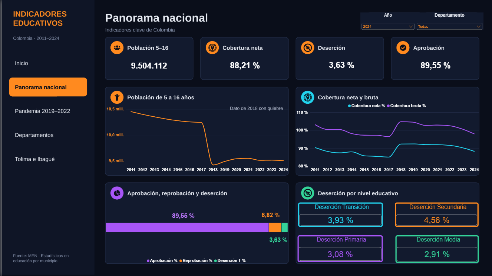

# Análisis de Indicadores Educativos en Colombia

**Proyecto formativo SENA | Python · Pandas · NumPy · Google Colab · Power BI**

## Descripción del proyecto

Proyecto de análisis de datos enfocado en el estudio de indicadores del sector educativo colombiano.

Se desarrolló un proceso de limpieza, transformación y validación de datos utilizando Python, Pandas y NumPy en Google Colab. Posteriormente, se construyó un dashboard interactivo en Microsoft Power BI para analizar indicadores educativos a nivel nacional, departamental y municipal.

## Objetivos

- Analizar indicadores de aprobación, reprobación y deserción escolar.
- Examinar la cobertura educativa neta y bruta.
- Comparar el comportamiento de los indicadores durante el periodo 2019-2022.
- Identificar diferencias entre departamentos y municipios.
- Analizar el contexto educativo de Tolima e Ibagué.

## Tecnologías utilizadas

| Tecnología | Aplicación |
|---|---|
| Python | Procesamiento de datos |
| Pandas | Limpieza y manipulación de datos |
| NumPy | Operaciones numéricas |
| Google Colab | Desarrollo del notebook |
| Power BI | Análisis y visualización |
| Excel | Exportación y consulta de datos |

## Metodología

1. Obtención de datos desde una fuente oficial del Ministerio de Educación Nacional.
2. Limpieza y transformación mediante Python, Pandas y NumPy.
3. Validación de consistencia y calidad de los datos.
4. Preparación del dataset para su utilización en Power BI.
5. Desarrollo de un dashboard interactivo.
6. Análisis de indicadores y comparación territorial.

## Resultados del procesamiento

| Métrica | Resultado |
|---|---:|
| Registros originales | 15.707 |
| Registros finales | 15.704 |
| Columnas | 41 |
| Filas sin indicadores válidos | 29 |
| Valores vacíos finales | 21.124 |
| Duplicados año + municipio | 0 |

## Dashboard

El informe contiene cinco páginas:

1. Presentación.
2. Panorama nacional.
3. Análisis del periodo de pandemia (2019-2022).
4. Comparación entre departamentos.
5. Análisis de Tolima e Ibagué.

### Vista previa

## Estructura del repositorio

- `01_Datos/`: datasets originales y procesados.
- `02_Python/`: notebook de limpieza y preparación.
- `03_PowerBI/`: archivo PBIX.
- `04_Capturas/`: imágenes del dashboard.
- `05_Documentacion/`: resultados y documentación técnica.

## Objetivo de aprendizaje

Aplicar herramientas de programación y Business Intelligence para transformar datos en información útil para el análisis y la toma de decisiones.

## Autoría

Proyecto formativo desarrollado en el SENA.

