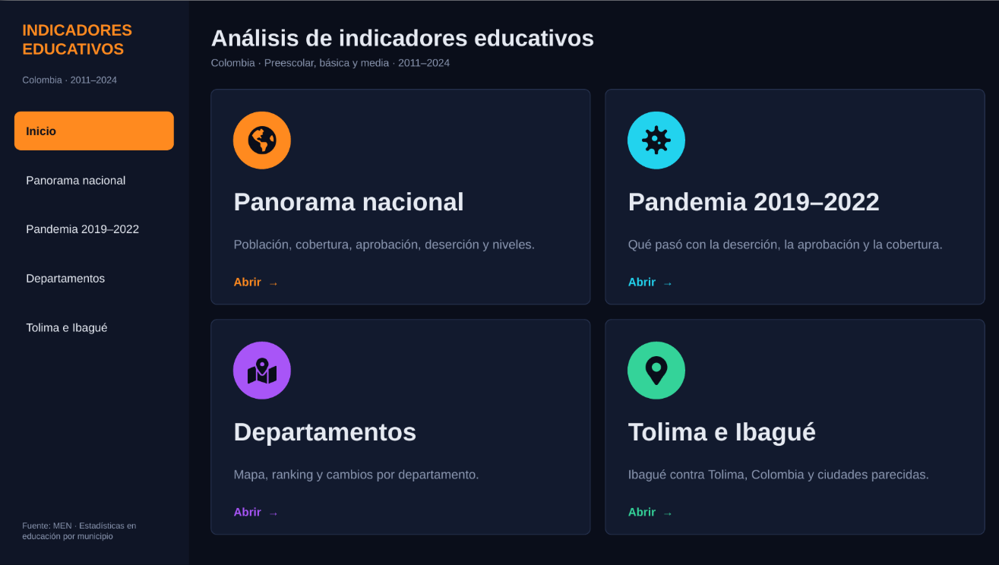
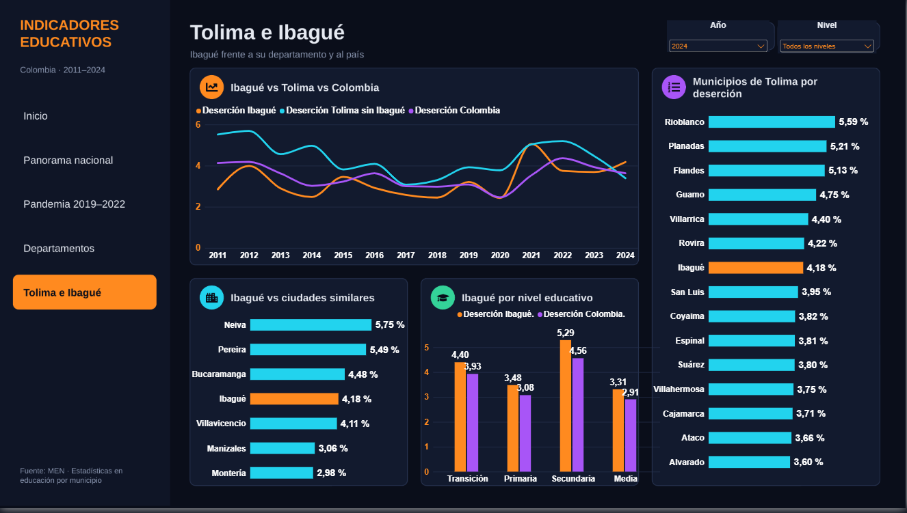

# Análisis de Indicadores Educativos en Colombia

Proyecto formativo del SENA · Python · Pandas · NumPy · Google Colab · Power BI

## Descripción

Análisis de indicadores del sector educativo colombiano a partir de las estadísticas del Ministerio de Educación Nacional (MEN). Se limpiaron y validaron los datos con Python en Google Colab y se construyó un dashboard interactivo en Power BI que compara el panorama nacional, el periodo de pandemia, los departamentos y el caso de Tolima e Ibagué.

## Objetivos

- Analizar los indicadores de aprobación, reprobación y deserción escolar.
- Examinar la cobertura educativa neta y bruta.
- Comparar el comportamiento de los indicadores durante 2019–2022.
- Identificar diferencias entre departamentos y municipios.
- Analizar el contexto educativo de Tolima e Ibagué.

## Tecnologías

| Tecnología | Uso |
|---|---|
| Python | Procesamiento de datos |
| Pandas | Limpieza y manipulación |
| NumPy | Operaciones numéricas |
| Google Colab | Desarrollo del notebook |
| Power BI | Análisis y visualización |
| Excel | Exportación y consulta de datos |

## Fuente de los datos

- **Entidad:** Ministerio de Educación Nacional (MEN), Colombia.
- **Conjunto:** Estadísticas en educación en preescolar, básica y media por municipio.
- **Portal de descarga:** [URL del portal]
- **Archivo original:** `MEN_ESTADISTICAS_EN_EDUCACION_EN_PREESCOLAR,_BÁSICA_Y_MEDIA_POR_MUNICIPIO_20261031.csv`
- **Cobertura:** 2011 a 2024, por municipio.
- **Licencia:** [consultar en el portal del MEN]

Los límites departamentales del mapa vienen del DANE (Marco Geoestadístico Nacional 2025), simplificados a partir de [ytolosa/mapas-colombia](https://github.com/ytolosa/mapas-colombia), bajo licencia CC BY 4.0.

## Metodología

1. Obtención de los datos desde la fuente oficial del MEN.
2. Limpieza y transformación con Python, Pandas y NumPy: códigos con ceros a la izquierda, separadores de miles mal leídos, porcentajes en texto, nombres de municipios y filas nacionales.
3. Validación de consistencia: duplicados, correspondencia entre municipio y departamento, sumas de aprobación, reprobación y deserción, y comparación celda por celda contra la fuente.
4. Exportación a Excel para Power BI.
5. Desarrollo del dashboard interactivo.
6. Análisis de indicadores y comparación territorial.

## Resultados del procesamiento

| Métrica | Resultado |
|---|---|
| Registros originales | 15.707 (incluye 3 filas NACIONAL) |
| Registros finales | 15.704 (1.122 municipios por año) |
| Columnas | 41 |
| Filas sin indicadores válidos | 29 |
| Valores vacíos finales | 21.124 |
| Duplicados año + municipio | 0 |

Ningún valor que tenía dato en la fuente cambió de número.

## Hallazgos principales

- **Colombia, 2024:** cobertura neta de 88,21 %, deserción de 3,63 % y aprobación de 89,55 %.
- **Pandemia:** la deserción pasa de 3,09 % (2019) a 2,46 % (2020), sube a 3,53 % (2021) y llega a 4,36 % (2022). Entre 2019 y 2022, 856 municipios empeoraron su deserción y 260 mejoraron.
- **Departamentos, 2024:** Putumayo tiene la mayor deserción (6,78 %). San Andrés, Providencia y Santa Catalina tiene la menor (1,95 %), y es el valor más bajo en 8 de los 14 años.
- **Ibagué, 2024:** deserción de 4,18 %, por encima del promedio nacional (3,63 %). En secundaria, Ibagué tiene 5,29 % frente a 4,56 % del país.

## Limitaciones de los datos

- **Quiebre en 2018:** la población de 5 a 16 años baja de 10,24 millones (2017) a 9,42 millones (2018). Es una discontinuidad de la serie, no un cambio real. Comparar antes y después de 2018 debe hacerse con cuidado.
- **Ceros y vacíos:** 29 filas tienen todos los indicadores en 0 en la fuente. Se dejaron vacías porque se interpretaron como "sin dato". Es una decisión de limpieza, no un dato de la fuente.
- **Valores mayores a 100 %:** la cobertura neta, la bruta y la tasa de matriculación superan 100 % en algunas filas. Viene así de la fuente, por estudiantes de edad mayor a la del nivel y por proyecciones de población.
- **Columnas sin datos:** tamaño promedio de grupo y sedes conectadas a internet no tienen datos desde 2018.
- **Alcance:** la base mide solo la población de 5 a 16 años, no la población total del país.

El detalle de cada punto está en la hoja `Notas` del Excel.

## Cómo reproducir el análisis

1. Descarga el CSV original desde el portal del MEN.
2. Abre el notebook `02_Python/limpieza_men_20261031.ipynb` en Google Colab.
3. Sube el CSV al panel de archivos de Colab.
4. Cambia la ruta de lectura en la primera celda.
5. Ejecuta todas las celdas. Debes ver 15.707 filas originales, 15.704 finales y 21.124 vacíos.

El resultado queda en `01_Datos/MEN_ESTADISTICAS_LIMPIO`, con la base en la hoja `Datos` y los avisos en la hoja `Notas`.

## Dashboard

El informe tiene cinco páginas:

1. Presentación.
2. Panorama nacional.
3. Pandemia 2019–2022.
4. Departamentos.
5. Tolima e Ibagué.

### Vista previa





## Estructura del repositorio

```
01_Datos/          CSV original, Excel para Power BI y mapa (TopoJSON)
02_Python/         Notebook de limpieza y validación
03_PowerBI/        Archivo .pbix del dashboard
04_Capturas/       Imágenes del dashboard
05_Documentacion/  Guía de construcción y documentación técnica
```

## Objetivo de aprendizaje

Aplicar herramientas de programación y Business Intelligence para transformar datos en información útil para el análisis y la toma de decisiones.

## Autoría

Proyecto formativo desarrollado en el SENA por Javier Andrés Campos Ariza 
